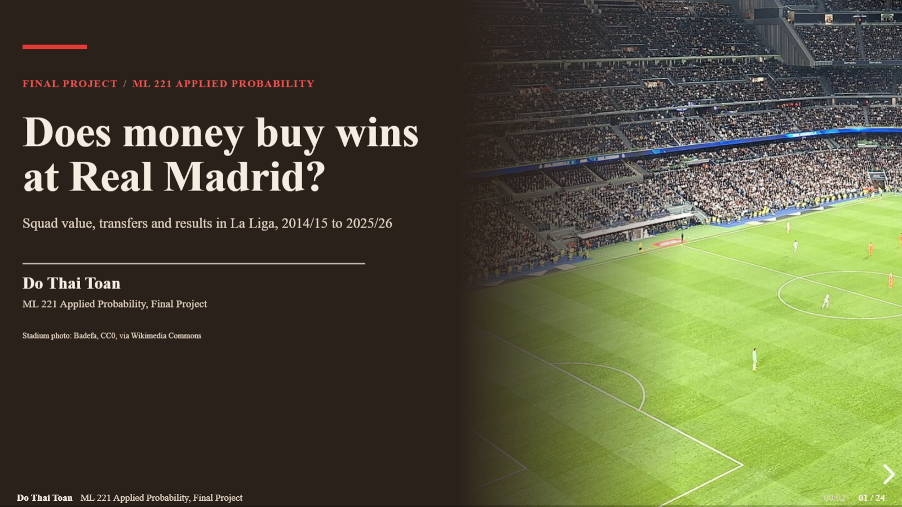
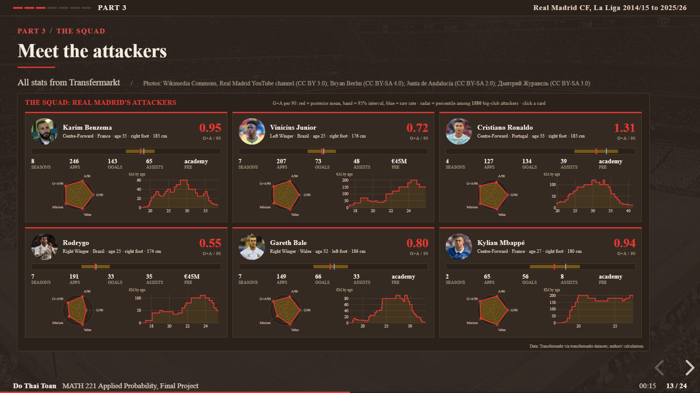
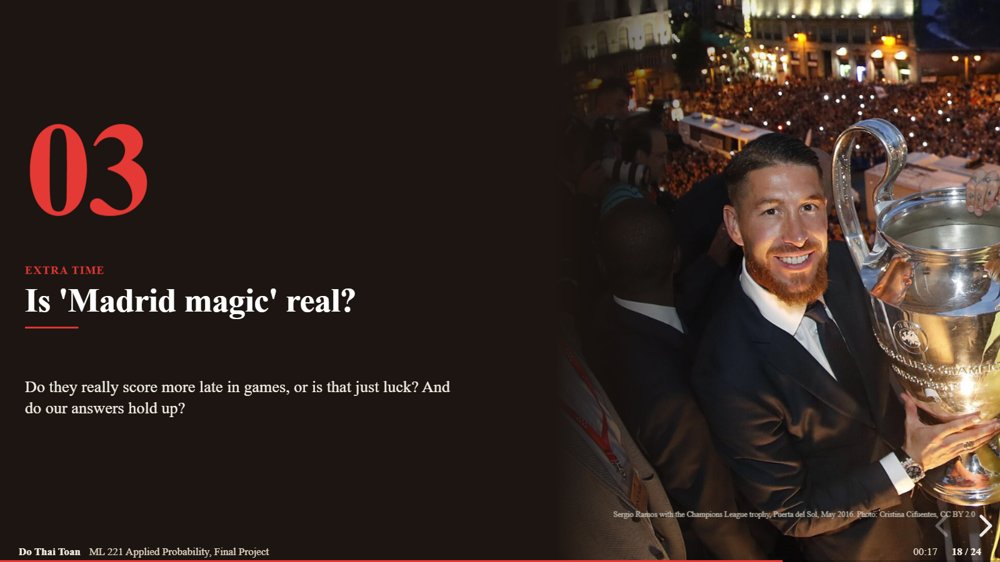
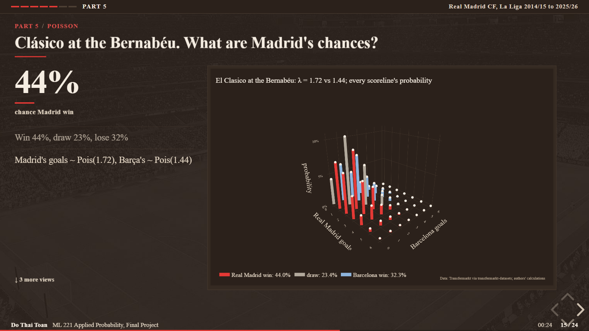

# Does money buy wins at Real Madrid?

**Seven probability models on twelve seasons of Transfermarkt data, presented as a live, interactive deck.**
Final project for ML 221 Applied Probability by **Do Thai Toan**.

[](https://github.com/ThaiToando/ML221-RealMadrid_Probability/actions/workflows/ci.yml)


**[▶ Open the live deck](https://ThaiToando.github.io/ML221-RealMadrid_Probability/)** ·
**[⬇ Download the one-file presentation](https://ThaiToando.github.io/ML221-RealMadrid_Probability/Real_Madrid_MATH221_Presentation.html)** ·
[PDF](docs/deck.pdf) · [PowerPoint](docs/deck.pptx)



## The question

Real Madrid spend more on players than almost any club in the world, and they win a lot. Is the winning just the money,
or is there something the budget doesn't explain? Each part of the project answers one piece of that question with a
different tool from probability and statistics, and every number in the deck is computed from the data.

## Results

<!-- results:start -->
| Part | Question | Answer |
|---|---|---|
| 1 · Regression | Does squad value predict league points? | Squad value explains **59%** of the variation in points; +20% value ≈ +2.7 points a season |
| 1 · Residuals | Does Madrid beat its budget? | Above the budget line in **10 of 12** seasons |
| 2 · Beta-Binomial | How often do signings work out? | **37%** become regulars (raw 11/36, 95% credible interval 28%–47%) |
| 2 · Logistic | Can age and fee pick the better signing? | AUC **80%** |
| 3 · Gamma-Poisson | Real output or a hot streak? | Cristiano Ronaldo: **1.31** goals + assists per 90 after shrinkage |
| 4 · Quadratic + bootstrap | When is a player worth the most? | Attackers peak at **25.8** (95% CI 25.4–26.1) |
| 5 · Poisson | El Clásico at home? | Madrid win **44%**, draw 23% |
| 5 · Monte Carlo | What is Kylian Mbappé worth? | Title chance **22% → 7%** without him (10,000 simulated seasons) |
| 6 · Permutation test | Are the late goals luck? | 25% of Madrid's goals after 75' vs 22% for rivals, **p ≈ 0.0078** |
| 7 · MCMC, Weibull | Do the answers hold up? | Same posterior by MCMC; Weibull shape 1.15 |
<!-- results:end -->

*This table is generated from `data/processed/` by `python -m src.readme_results`; nothing in it is typed by hand.*

## What's in the deck

| | |
|---|---|
|  |  |
| Every chart is interactive: play, hover, rotate. Big numbers count up; formulas come with a plain-English line. | Player cards with licensed photos, radar charts and each attacker's Gamma posterior. |
|  |  |
| Section openers built on freely licensed photos of the club's iconic moments. | "Guess first" slides: the room guesses, one click reveals the model's answer. |

- 24 slides with ↓ extras: 30 interactive Plotly visuals, 8 Manim explainer videos (play, pause, scrub), speaker notes
- Runs fully offline; a single 43 MB HTML file contains the whole talk
- A Streamlit app for a live match simulator, a season simulator and a Bayesian transfer tracker

## The models

| Part | Method | Course topic |
|---|---|---|
| 1 | OLS of points on log relative squad value, residual checks, leverage | Least squares, log transforms, R² |
| 2 | Empirical-Bayes Beta-Binomial per club; logistic regression with ROC/AUC | Conjugacy, shrinkage, credible intervals, odds |
| 3 | Gamma-Poisson posterior for goals + assists per 90, prior by maximum likelihood | Poisson, Gamma, mixtures, MLE |
| 4 | Quadratic regression of log value on age, cluster bootstrap for the peak | Polynomial regression, vertex, bootstrap |
| 5 | Poisson GLM match model, 10,000 Monte Carlo seasons, star-player thinning | Independence, Skellam, LLN, CLT, Monte Carlo error |
| 6 | Permutation test and χ² goodness of fit on goal timing | Poisson process, order statistics, hypothesis tests |
| 7 | Metropolis MCMC and grid approximation; Weibull first-goal hazard | Bayesian computation, likelihood-ratio test |

## Run it

**See it:** open the [live deck](https://ThaiToando.github.io/ML221-RealMadrid_Probability/), or download
`Real_Madrid_MATH221_Presentation.html` and double-click it (Chrome or Edge). Keys: `F` full screen, `S` speaker notes,
`V` play/pause a video, `[` `]` skip 5 s, `↓` extras, `Alt`+click to zoom.

**With Docker** (nothing else to install):

```bash
docker compose up deck app            # deck at http://localhost:8000, app at http://localhost:8501
docker compose --profile pipeline run --rm pipeline   # optional: download the data and rebuild everything
```

**With Python 3.10+:**

```bash
python -m venv .venv && source .venv/bin/activate     # Windows: .venv\Scripts\activate
pip install -r requirements.txt -r requirements-dev.txt
python -c "from src.data_io import download_data; download_data()"   # Transfermarkt tables, ~200 MB
python run_all.py --deck --pdf      # analysis, visuals, docs/index.html, deck.pptx, deck.pdf
python -m src.single_file           # the one-file presentation
python -m tests.check_real          # prints READY TO PRESENT
```

The same tasks are in the `Makefile` (`make help`). The Manim videos are optional and need Manim, Pango and LaTeX
(`python -m src.manim_videos`).

**Quality checks:** `ruff check .` and `pytest` run on every push (GitHub Actions, Python 3.10 and 3.12), along with a
Docker build that serves the deck. `pre-commit install` runs the linter before each commit.

## Project layout

```
config.py              paths, club ids, seed
run_all.py             the whole pipeline in order
src/                   data_io, build_tables, part1..part7, deck_visuals, deck_sims, slides, single_file, style
app/app.py             Streamlit app
animations/            Manim scenes (rendered with python -m src.manim_videos)
data/processed/        model-ready tables (the raw download is not committed)
figures/               every chart, video and the licensed photos
docs/                  the deck (GitHub Pages), deck.pdf, deck.pptx, the one-file presentation
tests/                 unit tests and the go-live check
Dockerfile, docker-compose.yml, Makefile, pyproject.toml, .github/workflows/ci.yml
```

## Data and credits

- **Data:** Transfermarkt via [transfermarkt-datasets](https://github.com/dcaribou/transfermarkt-datasets).
  The raw tables are downloaded by `src/data_io.py` and are not stored in this repository.
- **Photos:** all from Wikimedia Commons under free licences (CC0, CC BY, CC BY-SA), credited on the slides and listed in
  [`figures/players/LICENSES.md`](figures/players/LICENSES.md) and [`figures/backgrounds/LICENSES.md`](figures/backgrounds/LICENSES.md).
  Club crests were cropped out; this is an independent student project, not affiliated with Real Madrid CF.
- **Code:** MIT licence (see [LICENSE](LICENSE)).

All findings are associations, not causal effects.
