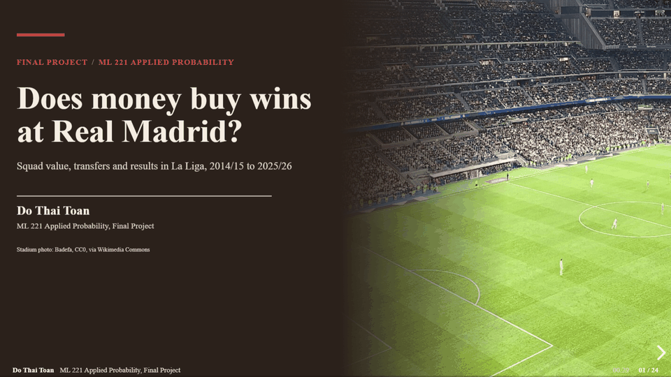
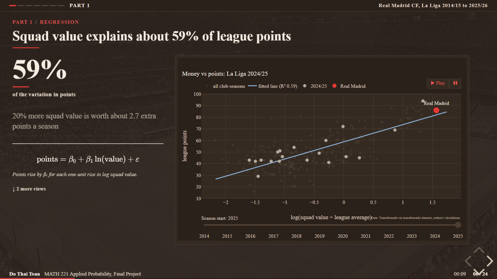
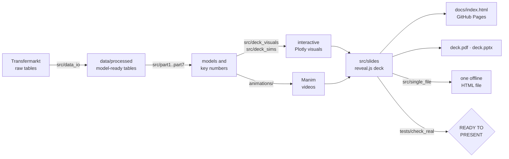

<div align="center">

# Does money buy wins at Real Madrid?

**Seven probability models · twelve La Liga seasons · one live, interactive deck**

*ML 221 Applied Probability, Final Project · by **Do Thai Toan***

<br>

[](https://ThaiToando.github.io/ML221-RealMadrid_Probability/)
[](https://ThaiToando.github.io/ML221-RealMadrid_Probability/Real_Madrid_MATH221_Presentation.html)
[](docs/deck.pdf)

[](https://github.com/ThaiToando/ML221-RealMadrid_Probability/actions/workflows/ci.yml)
[](https://ThaiToando.github.io/ML221-RealMadrid_Probability/)


<br>



</div>

---

## Contents

[The question](#the-question) · [Highlights](#highlights) · [Results](#results) · [The models](#the-models) ·
[How it's built](#how-its-built) · [Run it](#run-it) · [Project layout](#project-layout) · [Data and credits](#data-and-credits)

## The question

Real Madrid spend more on players than almost any club in the world, and they win a lot. **Is the winning just the
money, or is there something the budget doesn't explain?** Each part of the project answers one piece of that
question with a different tool from probability and statistics. Every number in the deck is computed from the data
by code; none is typed by hand.

## Highlights

- **A presentation you can use, not just read.** Interactive Plotly visuals (play, hover, rotate in 3D), Manim
  explainer videos with full playback control, speaker notes and a presenter clock.
- **Built for a live room.** "Guess first" slides hide the answer until a click; big numbers count up; every formula
  is followed by the same idea in plain English.
- **Runs anywhere.** The whole talk also ships as a single offline HTML file (no internet, no install), plus PDF and
  PowerPoint copies.
- **Reproducible end to end.** One command rebuilds the data tables, models, figures, videos and deck; a go-live check
  confirms every chart was built from the real data.
- **Engineered like software.** Tested and linted in CI on Python 3.10 and 3.12, containerised with Docker, with a
  Makefile, pre-commit hooks and a single `pyproject.toml`.

## Results

<!-- results:start -->
| Part | Question | Answer |
|---|---|---|
| 1 · Regression | Does squad value predict league points? | Squad value explains **59%** of the variation in points; +20% value ≈ +2.7 points a season |
| 1 · Residuals | Does Madrid beat its budget? | Above the budget line in **10 of 12** seasons |
| 2 · Beta-Binomial | How often do signings work out? | **37%** become regulars (raw 11/36, 95% credible interval 28%–47%) |
| 2 · Logistic | Can age and fee pick the better signing? | AUC **80%** |
| 3 · Gamma-Poisson | Real output or a hot streak? | Cristiano Ronaldo: **1.31** goals + assists per 90 after shrinkage |
| 4 · Quadratic + bootstrap | When is a player worth the most? | Attackers peak at **25.8** (95% CI 25.4–26.1) |
| 5 · Poisson | El Clásico at home? | Madrid win **44%**, draw 23% |
| 5 · Monte Carlo | What is Kylian Mbappé worth? | Title chance **22% → 7%** without him (10,000 simulated seasons) |
| 6 · Permutation test | Are the late goals luck? | 25% of Madrid's goals after 75' vs 22% for rivals, **p ≈ 0.0078** |
| 7 · MCMC, Weibull | Do the answers hold up? | Same posterior by MCMC; Weibull shape 1.15 |
<!-- results:end -->

<sub>Generated from <code>data/processed/</code> by <code>python -m src.readme_results</code>. All findings are associations, not causal effects.</sub>

<table>
<tr>
<td width="50%"><br><sub><b>Part 1.</b> Every season plays out on the chart; formulas come with a plain-English line.</sub></td>
<td width="50%"><br><sub><b>Part 3.</b> Player cards with licensed photos, radar charts and each attacker's Gamma posterior.</sub></td>
</tr>
<tr>
<td><br><sub><b>Part 5.</b> "Guess first": the room guesses, one click reveals the model's answer.</sub></td>
<td><br><sub>Section openers built on freely licensed photos of the club's iconic moments.</sub></td>
</tr>
</table>

## The models

| Part | Method | Course topic |
|---|---|---|
| 1 | OLS of points on log relative squad value, residual checks, leverage | Least squares, log transforms, R² |
| 2 | Empirical-Bayes Beta-Binomial per club; logistic regression with ROC/AUC | Conjugacy, shrinkage, credible intervals, odds |
| 3 | Gamma-Poisson posterior for goals + assists per 90, prior by maximum likelihood | Poisson, Gamma, mixtures, MLE |
| 4 | Quadratic regression of log value on age, cluster bootstrap for the peak | Polynomial regression, vertex, bootstrap |
| 5 | Poisson GLM match model, Monte Carlo seasons, star-player thinning | Independence, Skellam, LLN, CLT, Monte Carlo error |
| 6 | Permutation test and χ² goodness of fit on goal timing | Poisson process, order statistics, hypothesis tests |
| 7 | Metropolis MCMC and grid approximation; Weibull first-goal hazard | Bayesian computation, likelihood-ratio test |

## How it's built



**Stack:** Python · pandas · NumPy · SciPy · statsmodels · scikit-learn · Plotly · Matplotlib · Manim · reveal.js ·
KaTeX · Streamlit · Playwright · Docker · GitHub Actions · ruff · pytest

## Run it

**Just watch it:** open the [live deck](https://ThaiToando.github.io/ML221-RealMadrid_Probability/), or download the
[one-file presentation](https://ThaiToando.github.io/ML221-RealMadrid_Probability/Real_Madrid_MATH221_Presentation.html)
and double-click it in Chrome or Edge.

| Key | Action | Key | Action |
|---|---|---|---|
| `→` / `Space` | next | `↓` | extra views under a slide |
| `F` | full screen | `S` | speaker notes |
| `V` | play / pause video | `[` `]` | video back / forward 5 s |
| `Alt` + click | zoom | `O` | slide overview |

**With Docker** (nothing else to install):

```bash
docker compose up deck app                              # deck → http://localhost:8000 · app → http://localhost:8501
docker compose --profile pipeline run --rm pipeline     # optional: download the data and rebuild everything
```

**With Python 3.10+:**

```bash
python -m venv .venv && source .venv/bin/activate       # Windows: .venv\Scripts\activate
pip install -r requirements.txt -r requirements-dev.txt
python -c "from src.data_io import download_data; download_data()"     # Transfermarkt tables
python run_all.py --deck --pdf      # analysis, visuals, docs/index.html, deck.pptx, deck.pdf
python -m src.single_file           # the one-file presentation
python -m tests.check_real          # prints READY TO PRESENT
```

Common tasks are in the `Makefile` (`make help`). The Manim videos are optional and need Manim, Pango and LaTeX
(`python -m src.manim_videos`).

**Quality:** `ruff check .` and `pytest` run on every push (Python 3.10 and 3.12), and CI builds the Docker image and
checks that it serves the deck. `pre-commit install` runs the linter before each commit.

## Project layout

```
config.py              paths, club ids, random seed
run_all.py             the whole pipeline in order
go_live.py             one command from a fresh checkout to a checked deck
src/                   data_io · build_tables · part1..part7 · deck_visuals · deck_sims · slides · single_file · style
app/app.py             Streamlit app: live match, season simulator, transfer tracker
animations/            Manim scenes
data/processed/        model-ready tables (the raw download is not committed)
figures/               every chart and video, and the licensed photos
docs/                  the deck (GitHub Pages), deck.pdf, deck.pptx, the one-file presentation, README images
tests/                 unit tests and the go-live check
```

## Data and credits

- **Data:** Transfermarkt via [transfermarkt-datasets](https://github.com/dcaribou/transfermarkt-datasets). The raw
  tables are downloaded by `src/data_io.py` and are not stored here.
- **Photos:** Wikimedia Commons under free licences (CC0, CC BY, CC BY-SA), credited on the slides and listed in
  [`figures/players/LICENSES.md`](figures/players/LICENSES.md) and
  [`figures/backgrounds/LICENSES.md`](figures/backgrounds/LICENSES.md). Club crests are not used. This is an
  independent student project, not affiliated with or endorsed by Real Madrid CF.
- **Code:** [MIT licence](LICENSE). GitHub's *Cite this repository* button gives a ready-made citation.

<div align="center"><sub>Do Thai Toan · ML 221 Applied Probability</sub></div>
